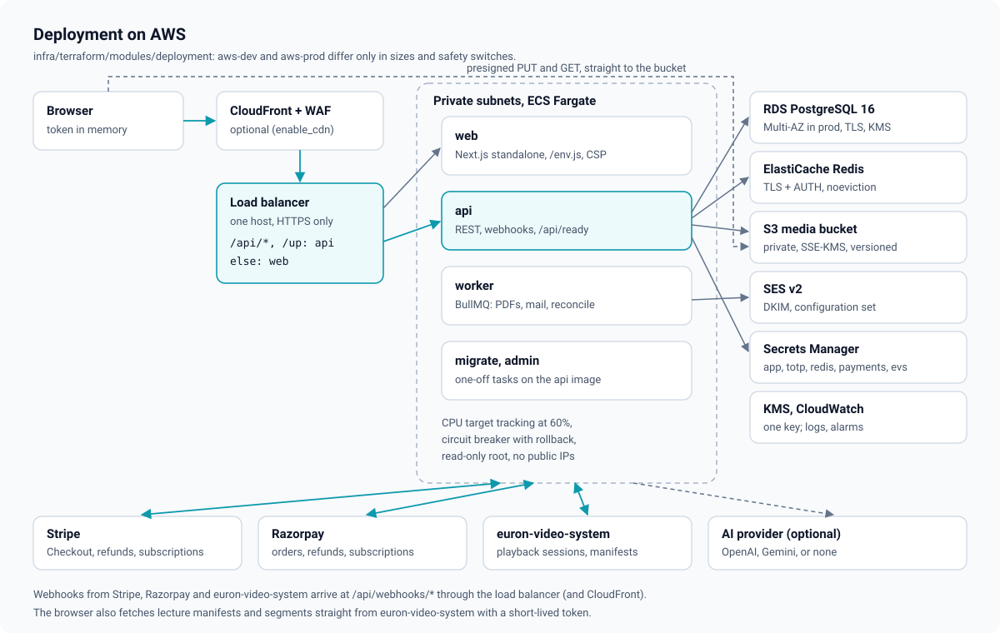

# High-level design

Euron Open LMS is a self-hosted learning platform for one academy. A deployment runs a
public catalog of courses and bundles, a classroom (video lectures played from
euron-video-system, articles, PDFs, quizzes and reviewed assignments), progress tracking
that ends in a verifiable certificate, course reviews and lecture Q&A, and commerce:
one-time purchases and all-access subscription plans paid through Stripe or Razorpay,
with coupons, tax, refunds, invoices and credit notes. Staff run it from an `/admin`
control plane in the same web app. An optional AI layer drafts quiz questions, suggests
rubric scores and polishes course copy; a person always decides.

This page describes the system as it is built: what runs, where data lives, how a request
travels and what happens when a piece fails. Deeper topics have their own pages:

| Topic | Page |
| --- | --- |
| Modules, layers, jobs, rate limits and errors inside the API | [LLD.md](LLD.md) |
| Tables, enums, constraints and indexes | [data-model.md](data-model.md) |
| Who may open course content, and why | [entitlements.md](entitlements.md) |
| Checkout, webhooks, fulfilment, refunds, subscriptions | [payments.md](payments.md) |
| Video lectures and euron-video-system | [video.md](video.md) |
| Question bank, quizzes, assignments and grading | [assessments.md](assessments.md) |
| Heartbeats, completion rules, rollup, certificates | [progress-and-certificates.md](progress-and-certificates.md) |
| Security controls and known limitations | [security.md](security.md) |
| STRIDE analysis | [threat-model.md](threat-model.md) |
| Decisions and their trade-offs | [adr/](adr/README.md) |

All code paths are relative to the repository root.

## 1. System context


Everyone uses the same web app; learners can also use the
[mobile app](https://github.com/euron-sde-team/euron-open-lms-mobile-application) (iOS and
Android), which calls the same API with native sessions
([ADR 0020](adr/0020-native-token-mode.md)). What a person can do depends on their platform role
(`users.role`) and, for authoring, on their role in a course's staff
(`course_staff.role`: `OWNER`, `EDITOR` or `GRADER`).

| Platform role | Can open | Defined in |
| --- | --- | --- |
| `LEARNER` | The catalog, the classroom of courses they have access to, My Learning, billing, account | `users.role` default |
| `INSTRUCTOR` | `/admin` areas overview, courses and grading, limited to the courses they are on the staff of | [`apps/api/src/domain/admin-permissions.ts`](../../apps/api/src/domain/admin-permissions.ts) |
| `SUPPORT` | overview, courses (read every course), learners, grading, orders (read), certificates, moderation | same |
| `FINANCE` | overview, orders (refunds and cancels), plans and bundles, coupons | same |
| `ADMIN` | Every area, including staff roles, settings and the audit trail | same |

Every admin service function opens with `requireArea(actor, area)`
([`apps/api/src/core/context.ts`](../../apps/api/src/core/context.ts)); the same table is
sent to the web app (`GET /api/admin/me`) so the sidebar shows only the areas the operator
may use. Course-level rights are a second check (`requireCourseStaff` in
[`apps/api/src/services/access.service.ts`](../../apps/api/src/services/access.service.ts)).

The outside systems:

| System | What the LMS uses it for | Code |
| --- | --- | --- |
| Stripe | Hosted Checkout (one-time and subscription mode), refunds, subscriptions; signed webhooks | [`services/payments/stripe.ts`](../../apps/api/src/services/payments/stripe.ts) |
| Razorpay | Orders and Checkout.js (a modal in the page), plans and subscriptions, refunds; signed webhooks | [`services/payments/razorpay.ts`](../../apps/api/src/services/payments/razorpay.ts) |
| euron-video-system (EVS) | Lecture video: the LMS mints playback sessions after its own entitlement check, lists videos for the editor, and receives `video.ready` / `video.failed` | [`integrations/evs.ts`](../../apps/api/src/integrations/evs.ts) |
| Mail (SES v2 or SMTP) | Verification, password reset, receipts, refunds, notification mail | [`integrations/mail/mailer.ts`](../../apps/api/src/integrations/mail/mailer.ts) |
| S3 (private bucket) | Covers, avatars, PDF lectures, resources, submission files, invoice and certificate PDFs | [`integrations/storage.ts`](../../apps/api/src/integrations/storage.ts) |
| AI provider (OpenAI, Gemini, the stub, or none) | Quiz drafts, grading suggestions, polish | [`integrations/ai/`](../../apps/api/src/integrations/ai/index.ts) |
| Firebase Cloud Messaging (or the stub, or none) | Push notifications to the mobile app, Android directly and iOS through APNs (`notify.push`, [ADR 0021](adr/0021-push-through-fcm-http-v1.md)) | [`integrations/push/`](../../apps/api/src/integrations/push/index.ts) |

Three flows bypass the API on purpose:

- **Media bytes** go straight between the browser and the bucket with presigned URLs. The
  API hands out a URL only for a declared, allowlisted file, then verifies what landed
  (size and magic bytes) before anything may use it ([ADR 0008](adr/0008-presigned-uploads-by-upload-id.md)).
- **Lecture video** streams from euron-video-system (or from the HLS/MP4 host, or YouTube).
  The LMS never uploads, stores or transcodes lecture video; it only decides who may play
  and hands the player a short-lived manifest URL ([video.md](video.md)).
- **Card and UPI details** never touch the LMS: Stripe is a full-page redirect to its
  hosted Checkout, Razorpay runs its Checkout.js modal in a frame.

## 2. Containers

The repository builds three images. The API image carries four entry points (esbuild
bundles listed in [`apps/api/package.json`](../../apps/api/package.json)).

| Container | Source | Image | Listens | Role |
| --- | --- | --- | --- | --- |
| Web app | `apps/web` (Next.js 15, standalone) | [`infra/docker/web.Dockerfile`](../../infra/docker/web.Dockerfile) | 3000 (3530 on the host locally) | Pages, the `/env.js` runtime config, the per-request CSP. Locally it also proxies `/api/*` to the API. |
| API | [`apps/api/src/index.ts`](../../apps/api/src/index.ts) | [`infra/docker/api.Dockerfile`](../../infra/docker/api.Dockerfile) | 5026 | REST under `/api`, the three webhooks, `/up` and `/api/ready` |
| Worker | [`apps/api/src/worker.ts`](../../apps/api/src/worker.ts) | API image, `node dist/worker.js` | none | BullMQ workers for the `media`, `notify`, `invoices`, `certificates`, `billing`, `ai` and `maintenance` queues, and the repeatable schedules |
| Migrate (one-off) | [`db/migrate.ts`](../../db/migrate.ts) | API image, `node dist/migrate.js` | none | Applies pending SQL migrations under an advisory lock |
| CLI (one-off) | [`apps/api/src/cli.ts`](../../apps/api/src/cli.ts) | API image, `node dist/cli.js` | none | `admin:create` and `demo:seed` |
| Stubs (local and tests only) | [`apps/stubs`](../../apps/stubs/README.md) | [`infra/docker/stubs.Dockerfile`](../../infra/docker/stubs.Dockerfile) | 5119 | One server that speaks the Stripe, Razorpay, OpenAI and EVS APIs, with hosted pages, a fake Checkout.js, a test HLS stream and signed webhooks. Never deployed to AWS. |

Shared packages:

| Package | Holds |
| --- | --- |
| [`packages/types`](../../packages/types/src/index.ts) | DTOs and enums shared by the API and the web app ([`learning.ts`](../../packages/types/src/learning.ts), [`commerce.ts`](../../packages/types/src/commerce.ts), [`admin.ts`](../../packages/types/src/admin.ts)) |
| [`packages/api-client`](../../packages/api-client/src/index.ts) | The HTTP client (single-flight refresh, cross-tab lock), typed endpoint groups, uploads, pagination helpers, the `/env.js` serialiser |
| [`packages/ui`](../../packages/ui/src/index.ts) | The component library and design tokens the web app renders with |

### Deployed shape (AWS)



The composition lives in one Terraform module,
[`infra/terraform/modules/deployment/main.tf`](../../infra/terraform/modules/deployment/main.tf);
`envs/aws-dev` and `envs/aws-prod` only pick sizes and safety switches
([ADR 0009](adr/0009-fargate-behind-one-alb.md)).

| | aws-dev | aws-prod |
| --- | --- | --- |
| Availability zones, NAT | 2, one shared NAT | 3, one NAT per AZ, interface endpoints |
| RDS PostgreSQL 16 | single AZ, 3 days of backups | Multi-AZ, 14 days, deletion protection |
| ElastiCache Redis | 1 node | 2 nodes with automatic failover |
| Tasks (min to max) | api 1 to 2, worker 1, web 1 to 2 | api 2 to 10, worker 2 to 6, web 2 to 6 |
| CloudFront + WAF | off by default (`enable_cdn = false`) | on by default |
| Log retention | 14 days | 365 days |

**One origin.** The ALB routes `/api/*` and `/up` on the deployment's host to the API
(listener priority 100) and every other path to the web app (priority 200). Payment and
video webhooks arrive on the API rule like any other request
(`/api/webhooks/stripe`, `/api/webhooks/razorpay`, `/api/webhooks/evs`; the Terraform
output `webhook_urls` lists them). The browser only ever talks to `https://<domain>`, the
refresh cookie (scoped to `/api/auth`) is first-party and the app needs no CORS for
itself. `CORS_ORIGINS` is still set to the app URL and enforced.

**With the CDN on**, CloudFront sends a secret `X-Origin-Verify` header that both listener
rules require; anything else gets 403 from the ALB. `/_next/static/*` is cached for a year;
`/api/*` and pages are never cached and every header, cookie, query string and the raw body
are forwarded, so webhook signatures still verify
([`infra/terraform/modules/cdn/main.tf`](../../infra/terraform/modules/cdn/main.tf)).
`TRUST_PROXY` becomes 2.

**Runtime configuration of the web app.** `NEXT_PUBLIC_*` values are inlined at build time,
so the web server renders `/env.js` per request from its own environment
([`apps/web/src/app/env.js/route.ts`](../../apps/web/src/app/env.js/route.ts),
[`apps/web/src/lib/runtime-env.ts`](../../apps/web/src/lib/runtime-env.ts)). One web image
runs in every environment. The CSP's media and video origins come from `MEDIA_ORIGINS` and
`VIDEO_ORIGINS` at run time ([`apps/web/src/middleware.ts`](../../apps/web/src/middleware.ts)).

### Local shape

`make up` starts the same containers with Docker Compose
([`deploy/compose/compose.yaml`](../../deploy/compose/compose.yaml) plus
[`compose.floci.yaml`](../../deploy/compose/compose.floci.yaml)): Postgres (host port
5492), Redis (6429), Mailpit (UI 8046, SMTP 1046), the stubs (5119), the Floci AWS
emulator (4597) provisioned by the production Terraform modules
([`infra/terraform/envs/local-floci`](../../infra/terraform/envs/local-floci/main.tf)), a
one-shot `migrate`, then `api` (5026), `worker` and `web` (3530). Media lives in an
emulated S3 bucket with SSE-KMS, mail goes through emulated SES and is relayed to Mailpit,
and Stripe, Razorpay, EVS and the AI run against the stubs, which sign webhooks with the
same secrets the API verifies them with ([ADR 0019](adr/0019-stubs-that-sign-with-real-secrets.md)).
The Next server proxies `/api/*` to the API
([`apps/web/next.config.ts`](../../apps/web/next.config.ts)), standing in for the ALB's
path rule. See [quickstart-local.md](../guides/quickstart-local.md) and
[ADR 0010](adr/0010-floci-for-local-aws.md).

### Web app pages

The web app is a client of the REST contract ([`docs/api/rest-contract.md`](../api/rest-contract.md)).

| Area | Routes (under [`apps/web/src/app`](../../apps/web/src/app)) |
| --- | --- |
| Auth | `/login`, `/signup`, `/verify-email`, `/forgot-password`, `/reset-password`, `/goodbye` |
| Catalog | `/` (shelves), `/courses`, `/courses/[slug]`, `/bundles`, `/bundles/[slug]`, `/instructors/[username]`, `/plans` |
| Checkout | `/checkout`, `/checkout/orders/[orderId]` (the return page) |
| Classroom | `/learn/[slug]`, `/learn/[slug]/[itemId]` |
| Learner | `/my-learning`, `/notifications`, `/account` (profile, security, notifications, orders and `/account/orders/[orderId]`, subscription, privacy) |
| Certificates | `/verify`, `/verify/[serial]` (public) |
| Administration | `/admin` (overview), `/admin/courses`, `/admin/courses/[id]` (the editor), `/admin/categories`, `/admin/grading`, `/admin/grading/[submissionId]`, `/admin/learners`, `/admin/orders`, `/admin/orders/[id]`, `/admin/orders/subscriptions`, `/admin/plans`, `/admin/coupons`, `/admin/certificates`, `/admin/moderation`, `/admin/staff`, `/admin/settings`, `/admin/audit` |

Notification links built by the API (`hrefFor` in
[`apps/api/src/services/notification.service.ts`](../../apps/api/src/services/notification.service.ts))
target these routes.

## 3. The API process

One Node process serves HTTP ([`apps/api/src/index.ts`](../../apps/api/src/index.ts)).
Boot order:

1. Pin `TZ=UTC` before any import.
2. Load and validate configuration with zod
   ([`apps/api/src/core/config.ts`](../../apps/api/src/core/config.ts)). Run
   `assertProductionConfig()`: it returns the problems (committed secrets, `STORAGE=local`,
   `MAIL_MODE=outbox`, `JOBS_MODE=inline`, `AI_PROVIDER=stub`, `BCRYPT_ROUNDS` below 12,
   ...); with `NODE_ENV=production` it throws, so a misconfigured deployment fails at boot.
   Elsewhere they are logged as warnings. `productionWarnings()` logs what may run but
   should be fixed (no gateway configured, a missing webhook secret, a stub API base).
3. When `MIGRATE_ON_BOOT=true`, run the migration runner. The deployed stacks leave it off
   and run migrations as a separate task.
4. Register every job handler (needed for `JOBS_MODE=inline`).
5. Build the Express app (`createApp()` in [`apps/api/src/app.ts`](../../apps/api/src/app.ts),
   side-effect free so tests mount it in-process) and listen.
6. On `SIGTERM`/`SIGINT`: stop accepting HTTP, close queues, Redis and the pool. A 25 second
   timer forces exit.

The worker ([`apps/api/src/worker.ts`](../../apps/api/src/worker.ts)) boots the same way,
starts one BullMQ `Worker` per queue (concurrency 8 on `notify`, 4 on every other queue,
per task) and registers the repeatable schedules:

| Job | Every | What it does |
| --- | --- | --- |
| `billing.reconcile-pending` | 10 min | PENDING orders past their payment window: ask the gateway, then fulfil or expire |
| `billing.expire-subscriptions` | 30 min | Subscriptions whose period plus grace ended become EXPIRED, after asking the gateway whether a renewal was missed |
| `notify.email` | 5 min | Sweep of notifications not yet emailed in the last 3 days (catches what a failed per-notification job missed) |
| `maintenance.expire-uploads` | 30 min | Deletes pending uploads older than 24 h, rejected ones, and finished ones nothing references after 48 h |
| `maintenance.lift-suspensions` | 5 min | Ends timed suspensions that ran out |
| `maintenance.reconcile-counters` | 6 h | Recomputes enrollment, rating, item and reply counters and fixes only rows that drifted |
| `maintenance.purge-accounts` | 6 h | Anonymises accounts whose 14-day deletion grace is over |

Repeatable jobs are keyed by name and interval (`jobId: name`), so every worker task
registering them on boot leaves one schedule. Every step is a conditional `UPDATE` or
re-checks under a row lock, so a run on two workers at once is harmless. The full job list
is in [LLD.md](LLD.md#8-background-jobs).

## 4. Request lifecycle


The pieces, in order (all in [`apps/api/src/app.ts`](../../apps/api/src/app.ts) unless named):

1. **Request id.** A client `X-Request-Id` matching `^[\w-]{8,64}$` is kept, otherwise a new
   ULID. It is echoed in the response and in every error body.
2. **Access log.** `pino-http`, skipping `/up` and `/api/ready`; signed local media tokens in
   the URL are masked. Secret-bearing fields (passwords, tokens, codes, cookies) are redacted
   by the logger ([`apps/api/src/core/logger.ts`](../../apps/api/src/core/logger.ts)).
3. **Headers.** Helmet with `default-src 'none'` and `frame-ancestors 'none'` (the API serves
   JSON only); the cross-origin resource policy is relaxed so signed local media can load.
4. **CORS** for `CORS_ORIGINS` (default: `APP_WEB_URL`) with credentials, plus a second check
   that rejects any non-GET request carrying a foreign `Origin` (`403 CORS_ORIGIN_DENIED`).
5. **Webhooks first.** `/api/webhooks/evs` and `/api/webhooks/*` are mounted before the JSON
   parser with `express.raw` (1 MB), because their signatures cover the exact bytes received
   ([`apps/api/src/routes/index.ts`](../../apps/api/src/routes/index.ts), `WEBHOOK_MOUNTS`).
6. **Cookies and JSON** (1 MB).
7. **Authentication** per route: `authenticate` or `optionalAuth`
   ([`apps/api/src/middleware/auth.ts`](../../apps/api/src/middleware/auth.ts)). The JWT is
   verified and the user row reloaded, so a ban, a deactivation or a `token_version` bump
   takes effect on the next request. Identity always comes from the token.
8. **Rate limits** per route ([`apps/api/src/middleware/rate-limit.ts`](../../apps/api/src/middleware/rate-limit.ts)),
   stored in Redis so the budget is shared by every task.
9. **Controller**: parse input with strict zod schemas (`parse()` in
   [`apps/api/src/core/validate.ts`](../../apps/api/src/core/validate.ts)), call one service
   function with the `Actor`, send the DTO.
10. **Service**: business rules (pure decisions in `domain/`), usually inside
    `withTransaction`; presenters build DTOs.
11. **Errors**: an `HttpError` becomes its status and stable `code`; body-parser errors become
    `400 BAD_REQUEST` or `413 PAYLOAD_TOO_LARGE`; anything else is logged and returned as
    `500 INTERNAL` with the request id and no detail. Express 5 forwards rejected promises
    from async handlers, so controllers need no wrapper.

The two request paths that matter most have their own pages: a purchase
([payments.md](payments.md)) and playing a lecture ([video.md](video.md)).

## 5. After-commit effects

Writes that must also enqueue a job (a receipt, an invoice PDF, a certificate PDF, an email)
use the `Effects` buffer in [`apps/api/src/core/effects.ts`](../../apps/api/src/core/effects.ts):

```ts
return withTransaction(async (trx, fx) => {
  const invoice = await issueInvoice(paid, items, trx, { subscriptionId });
  await notify({ recipientId: order.user_id, type: "ORDER_PAID", ... }, fx, trx);
  fx.job("invoices.render", { invoiceId: invoice.id });
  fx.job("notify.receipt", { orderId: order.id });
  return { outcome: "FULFILLED", order: paid };
});
```

- `fx.job` and `fx.after` only queue a closure.
- `withTransaction` runs the transaction and calls `fx.flush()` only after a successful
  commit. A rolled-back fulfilment renders no invoice and mails no receipt.
- `flush()` runs the closures in order; a failing effect is logged and never fails the
  request, because the write already happened.
- `withEffects` gives the same contract for single-statement writes.

Delivery is at most once: a crash between commit and flush loses the effect. The scheduled
`notify.email` sweep re-sends notification mail that was never claimed; a lost
`invoices.render` or `certificates.render` leaves `pdf_key` NULL (the download answers
`409 INVOICE_RENDERING` / `CERTIFICATE_RENDERING`) until the job is enqueued again. There
is no outbox table ([ADR 0007](adr/0007-after-commit-effects.md)).

## 6. Background jobs: `JOBS_MODE`

Jobs are named handlers with a JSON payload
([`apps/api/src/jobs/registry.ts`](../../apps/api/src/jobs/registry.ts)). The queue is the
first segment of the name (`invoices.render` goes to the `invoices` queue).

| | `JOBS_MODE=queue` (default, every deployment) | `JOBS_MODE=inline` (tests, tiny installs) |
| --- | --- | --- |
| Where handlers run | The worker process | The API process, right after commit, inside `fx.flush()` |
| Retries | 5 attempts, exponential backoff from 5 s | None: an error is logged and swallowed |
| Scheduled jobs | Registered by the worker | None (no reconcile, no expiry, no mail sweep, no purge) |
| Request latency | Unaffected | The request waits for the handler (a PDF render, an email) |
| Production guard | OK | Refused by `assertProductionConfig` |

The integration suite runs inline so assertions are deterministic
([`apps/api/test/integration/env.ts`](../../apps/api/test/integration/env.ts)). See
[ADR 0006](adr/0006-bullmq-on-redis.md).

## 7. Scaling model

| Component | How it scales | What makes that safe |
| --- | --- | --- |
| API tasks | Horizontally, CPU target tracking at 60% | No in-process state that matters: sessions in Postgres, rate limits in Redis. Each task has its own pool (`DB_POOL_MAX`, default 10). Settings are cached per process for 5 s. No stickiness. |
| Worker tasks | Horizontally | BullMQ locks jobs; handlers are idempotent (PDF renders skip rows that have a `pdf_key`, fulfilment locks the order, email rows are claimed with a conditional update) |
| Repeatable schedules | Registered by every worker on boot | Keyed by name and interval, so one schedule exists |
| Web tasks | Horizontally | Stateless; `/env.js` and the CSP are rendered per request |
| Postgres | Vertically (instance class), storage autoscaling | Keyset pagination, partial indexes for hot lists (published catalog, pending orders, the grading queue, open reports), no `COUNT(*)` on lists ([data-model.md](data-model.md)) |
| Redis | Vertically; aws-prod runs two nodes with automatic failover | `noeviction`, so queued jobs are never evicted |
| Video | Not here | EVS serves every manifest and segment from its own origin and CDN |

## 8. Failure modes

| Failure | Effect | Recovery |
| --- | --- | --- |
| Postgres unavailable | `/api/ready` answers 503; the ALB takes tasks out of rotation | RDS Multi-AZ failover in aws-prod; new connections read the password from Secrets Manager |
| RDS rotates the master password | New connections fetch the new password (cached 60 s) | Automatic ([`apps/api/src/db/connection-config.ts`](../../apps/api/src/db/connection-config.ts)) |
| Redis unavailable | `/api/ready` fails; rate limits fall back to per-task in-memory limiters; jobs cannot be enqueued (logged, the write still commits) | ElastiCache failover in aws-prod. Lost receipts and PDF renders are not replayed; the `notify.email` sweep covers notification mail |
| Worker down | Jobs queue in Redis; images stay `COMPLETE` (shown only to their uploader); invoice and certificate PDFs wait; PENDING orders are not reconciled; subscriptions past their period are not expired | Jobs run when a worker returns |
| A gateway webhook is lost or late | The order stays PENDING | The Stripe return page asks Stripe once (`GET /api/checkout/orders/:id?sync=1`); the Razorpay modal posts its signed result (`/api/checkout/razorpay/confirm`); `billing.reconcile-pending` asks the gateway about every PENDING order past its window |
| Stripe or Razorpay unreachable at checkout | `502 GATEWAY_ERROR`; the order just created is closed as FAILED (`GATEWAY_ERROR`) | The learner retries with a new click |
| A webhook arrives while the database is down | The API answers 500; if the event row was already stored, it is deleted first | The gateway redelivers; the next delivery is processed, not taken for a duplicate |
| euron-video-system unreachable | Playback answers `502 VIDEO_SERVICE_UNAVAILABLE`; other lecture kinds still open | The player retries; nothing else depends on EVS |
| EVS not configured (or keys still `set-me`) | EVS lectures answer `503 VIDEO_NOT_CONFIGURED`; HLS, MP4 and YouTube lectures play | Configure `EVS_*` ([video-with-evs.md](../guides/video-with-evs.md)) |
| AI provider down or not configured | Quiz drafts and polish answer `503 AI_UNAVAILABLE` (no key) or `502 AI_FAILED`; grading suggestions likewise. `GET /api/meta` reports the AI flags off when no provider is usable, so the buttons are hidden | Authoring and grading work by hand |
| Mail transport fails | `sendMail` logs and returns `delivered: false`; the request succeeds | The learner can resend verification or request another reset. A notification email is claimed (`emailed_at` set) before it is sent, so a failed send is not retried; the in-app notification is still there |
| Crash between commit and effect flush | The write is durable, its job is lost | See section 5 |
| A deploy rolls out a bad image | The ECS deployment circuit breaker rolls back | Redeploy a previous image tag |

## 9. What is deliberately not here

- **Multi-tenancy.** One deployment is one academy; there is no tenant column
  ([ADR 0001](adr/0001-single-academy-per-deployment.md)).
- **Video hosting.** No lecture video is uploaded to the LMS
  ([ADR 0015](adr/0015-video-delegated-to-euron-video-system.md)).
- **Live classes, cohorts, discussion forums beyond lecture Q&A, or SCORM/xAPI import.**
- **Realtime push.** The web app refetches; there are no sockets.
- **A marketplace payout model.** Revenue goes to the academy's gateway account; there are
  no instructor payouts or revenue shares.
- **Foreign-exchange conversion.** Each currency has its own price in the price book
  ([ADR 0013](adr/0013-money-in-minor-units-with-a-server-price-book.md)).
- **Hard deletion of accounts.** Deletion anonymises the user row and erases learning
  traces but keeps orders and invoices ([security.md](security.md#8-privacy-and-account-deletion)).
