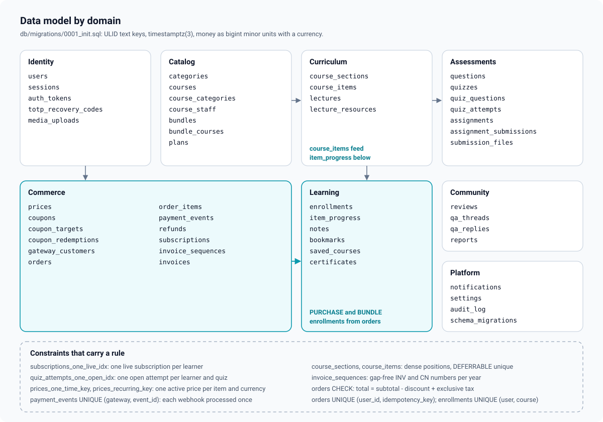

# Data model

The whole schema is one migration, [`db/migrations/0001_init.sql`](../../db/migrations/0001_init.sql),
applied by [`db/migrate.ts`](../../db/migrate.ts) (forward-only, checksummed, under an
advisory lock). Runtime queries use Kysely with types generated into
[`apps/api/src/db/types.ts`](../../apps/api/src/db/types.ts). This page groups the tables
by domain and explains the constraints that carry a rule.

## Conventions

- **Keys** are ULIDs stored as `text`, generated in the API by a monotonic factory
  ([`apps/api/src/core/ids.ts`](../../apps/api/src/core/ids.ts)). They sort by creation time
  and break ties in keyset cursors.
- **Timestamps** are `timestamptz(3)` and the API runs with `TZ=UTC`. Millisecond precision
  is exactly what a JS `Date` holds, so a cursor built from a `Date` equals the stored value
  ([ADR 0002](adr/0002-relational-schema-timestamptz3-ulids.md)).
- **Money** is a `bigint` count of the currency's minor unit (cents, paise) next to a
  `char(3)` ISO 4217 code: `amount_minor`, `subtotal_minor`, `total_minor`, ... Never a
  float, never an amount without its currency ([ADR 0013](adr/0013-money-in-minor-units-with-a-server-price-book.md)).
  The pool parses `int8` as a JavaScript number (`pg.types.setTypeParser(20, Number)` in
  [`apps/api/src/db/kysely.ts`](../../apps/api/src/db/kysely.ts)), which is exact far beyond
  any realistic order total (below 2^53).
- **Text limits** are `CHECK (length(...) ...)` in the schema, matched by the zod schemas.
- **Enums** are PostgreSQL enum types.
- **Extensions**: `citext` (emails, usernames, slugs, coupon codes), `pg_trgm` (name and
  title search).
- **Counters** (`enrollment_count`, `rating_count`, `rating_sum`, `item_count`,
  `duration_seconds`, `reply_count`, `redemption_count`) move in the same transaction as
  the rows they count; `maintenance.reconcile-counters` corrects drift.
- **No `OFFSET`**: every list has an index that serves its keyset order.
- **No tenant column**: one deployment is one academy ([ADR 0001](adr/0001-single-academy-per-deployment.md)).

## Enums

| Enum | Values |
| --- | --- |
| `user_role` | `LEARNER`, `INSTRUCTOR`, `SUPPORT`, `FINANCE`, `ADMIN` |
| `user_status` | `PENDING_VERIFICATION`, `ACTIVE`, `SUSPENDED`, `BANNED`, `DEACTIVATED` |
| `course_status` | `DRAFT`, `PUBLISHED`, `ARCHIVED` |
| `access_mode` | `FREE`, `PAID`, `SUBSCRIPTION_ONLY` |
| `course_staff_role` | `OWNER`, `EDITOR`, `GRADER` |
| `item_kind` / `lecture_kind` | `LECTURE`, `QUIZ`, `ASSIGNMENT` / `VIDEO`, `ARTICLE`, `PDF` |
| `video_provider` / `video_status` | `EVS`, `HLS`, `MP4`, `YOUTUBE` / `PROCESSING`, `READY`, `FAILED` |
| `question_kind` / `text_match` | `SINGLE`, `MULTI`, `TRUE_FALSE`, `SHORT_TEXT` / `EXACT`, `CASE_INSENSITIVE`, `REGEX` |
| `quiz_selection` / `reveal_policy` / `attempt_status` | `FIXED`, `RANDOM` / `AFTER_SUBMIT`, `AFTER_PASS`, `NEVER` / `IN_PROGRESS`, `SUBMITTED`, `EXPIRED` |
| `submission_status` | `SUBMITTED`, `CHANGES_REQUESTED`, `APPROVED`, `REJECTED` |
| `enrollment_source` / `enrollment_status` | `FREE`, `PURCHASE`, `BUNDLE`, `SUBSCRIPTION`, `GRANT` / `ACTIVE`, `REVOKED` |
| `sellable_type` / `billing_interval` / `catalog_status` | `COURSE`, `BUNDLE`, `PLAN` / `MONTH`, `YEAR` / `DRAFT`, `ACTIVE`, `ARCHIVED` |
| `gateway` / `order_kind` | `STRIPE`, `RAZORPAY`, `FREE` / `ONE_TIME`, `SUBSCRIPTION` |
| `order_status` | `PENDING`, `PAID`, `FAILED`, `EXPIRED`, `CANCELED`, `PARTIALLY_REFUNDED`, `REFUNDED` |
| `refund_status` | `PENDING`, `SUCCEEDED`, `FAILED` |
| `coupon_kind` / `coupon_scope` | `PERCENT`, `FIXED` / `ALL`, `COURSES`, `BUNDLES`, `PLANS`, `SPECIFIC` |
| `subscription_status` | `INCOMPLETE`, `TRIALING`, `ACTIVE`, `PAST_DUE`, `CANCELED`, `EXPIRED` |
| `invoice_kind` | `INVOICE`, `CREDIT_NOTE` |
| `upload_purpose` / `upload_kind` / `upload_status` | `AVATAR`, `COURSE_COVER`, `LECTURE_PDF`, `LECTURE_RESOURCE`, `SUBMISSION`, `BRANDING` / `IMAGE`, `VIDEO`, `AUDIO`, `PDF`, `DOCUMENT`, `ARCHIVE`, `OTHER` / `PENDING`, `COMPLETE`, `READY`, `REJECTED`, `DELETED` |
| `content_status` | `PUBLISHED`, `HIDDEN`, `DELETED` |
| `report_target` / `report_reason` / `report_status` | `REVIEW`, `QA_THREAD`, `QA_REPLY` / `SPAM`, `HARASSMENT`, `OFF_TOPIC`, `SPOILER`, `INAPPROPRIATE`, `OTHER` / `OPEN`, `RESOLVED` |
| `notification_type` | 14 types from `ORDER_PAID` to `COURSE_UPDATED` |
| `auth_token_type` | `VERIFY_EMAIL`, `RESET_PASSWORD` |

## Tables by domain

### Identity

| Table | Holds | Constraints worth knowing |
| --- | --- | --- |
| `users` | Account, profile fields, role, status, TOTP state, email preferences, `preferred_currency`, `deletion_requested_at`, `token_version` | `email` and `username` unique (citext); `username` pattern; `display_name` 1 to 80, cleaned at write time of emails and phone numbers; `certificate_name` is what certificates print; `totp_secret` is ciphertext; trigram index over name, username and email for the admin search; partial index on staff roles |
| `sessions` | One row per refresh token | `token_hash` unique (SHA-256); `family_id` groups every rotation of one login; `replaced_by` marks a rotated row (reuse detection); partial index on live sessions |
| `auth_tokens` | Email verification and password reset tokens | `token_hash` unique; single use (`used_at`) |
| `totp_recovery_codes` | HMACs of the ten recovery codes | Primary key `(user_id, code_hash)` |
| `media_uploads` | Every upload, its declared and verified size, status, thumbnail key | `storage_key` unique; partial index on PENDING for the expiry job |

### Catalog

| Table | Holds | Constraints worth knowing |
| --- | --- | --- |
| `categories` | The taxonomy | `slug` unique |
| `courses` | Course page fields, status, `access_mode`, `included_in_subscription`, `certificate_enabled`, `featured`, counters, generated `search` tsvector | `slug` unique with a pattern; `CHECK (access_mode <> 'SUBSCRIPTION_ONLY' OR included_in_subscription)`: a plan-only course must be in the plan; partial indexes `courses_catalog_idx` and `courses_popular_idx` on PUBLISHED rows; GIN on `search`, trigram on `title` |
| `course_categories` | Course to category | Composite primary key |
| `course_staff` | Who teaches and who may edit (`OWNER`, `EDITOR`, `GRADER`), `listed` for the course page | Primary key `(course_id, user_id)`: one role per person per course |
| `bundles`, `bundle_courses` | Bundles and their ordered courses | `slug` unique; composite key |
| `plans` | All-access subscription plans, `trial_days` 0 to 90 | `slug` unique |

### Curriculum

| Table | Holds | Constraints worth knowing |
| --- | --- | --- |
| `course_sections` | Ordered sections | `UNIQUE (course_id, position) DEFERRABLE INITIALLY IMMEDIATE`, `position >= 0` |
| `course_items` | Ordered items of three kinds, `is_preview`, `duration_seconds` | `UNIQUE (section_id, position) DEFERRABLE INITIALLY IMMEDIATE` |
| `lectures` | One row per LECTURE item: kind, `video_provider`, `video_ref`, `video_status`, article `body`, `pdf_upload_id` | `CHECK ((lecture_kind = 'VIDEO') = (video_provider IS NOT NULL))`; partial index on `video_ref` for EVS rows (the webhook's lookup) |
| `lecture_resources` | Downloads and links per lecture | `CHECK ((upload_id IS NULL) <> (url IS NULL))`: exactly one of a file or a link |

**Dense positions with deferrable uniques.** Positions are `0..n-1` per parent and unique.
A move renumbers every sibling; with an immediate unique constraint, swapping two rows
would collide halfway. The repository runs
`SET CONSTRAINTS course_sections_position_key, course_items_position_key DEFERRED` inside
the move transaction ([`apps/api/src/repositories/curriculum.repository.ts`](../../apps/api/src/repositories/curriculum.repository.ts)),
so uniqueness is checked once at commit. The course row lock taken by every curriculum
write serialises editors, so positions stay dense.

### Assessments

| Table | Holds | Constraints worth knowing |
| --- | --- | --- |
| `questions` | The course question bank: prompt, explanation, points 1 to 100, `options` JSON with `correct` flags, `accepted_answers`, `match_mode`, `tags`, `archived_at` | Partial index on unarchived rows; GIN on `tags` for RANDOM draws |
| `quizzes` | One row per QUIZ item: selection, `draw_count`, `draw_tags`, `pass_percent`, `time_limit_seconds` 30 to 86400, `max_attempts` (NULL = unlimited), shuffles, `reveal` | `CHECK (selection = 'FIXED' OR draw_count IS NOT NULL)` |
| `quiz_questions` | FIXED quizzes' questions in order | Composite key |
| `quiz_attempts` | One row per attempt: `number`, status, the frozen `snapshot` (questions, option order, points and the answer key), `answers`, score, `deadline_at` | `UNIQUE (quiz_item_id, user_id, number)`; partial unique `quiz_attempts_one_open_idx ON (quiz_item_id, user_id) WHERE status = 'IN_PROGRESS'`: at most one open attempt per learner per quiz |
| `assignments` | One row per ASSIGNMENT item: instructions, `rubric` JSON, `pass_points`, `due_days`, `allow_late`, accepted kinds, `max_files` | |
| `assignment_submissions` | Every version of a learner's submission: body, url, status, `is_late`, `scores`, `total_points`, `feedback`, `ai_suggestion`, reviewer | `UNIQUE (item_id, user_id, version)`: concurrent submits cannot both become version n; partial index `assignment_submissions_queue_idx` on SUBMITTED rows (the grading queue) |
| `submission_files` | Uploads attached to a submission | Composite key |

Why snapshots: see [assessments.md](assessments.md) and
[ADR 0016](adr/0016-quiz-attempt-snapshots.md).

### Commerce

| Table | Holds | Constraints worth knowing |
| --- | --- | --- |
| `prices` | The price book: one price per sellable, currency and (for plans) interval, `compare_at_minor` for display, `gateway_refs` (cached Stripe Price and Razorpay Plan ids) | `CHECK ((sellable_type = 'PLAN') = (interval IS NOT NULL))`; partial unique `prices_one_time_key (sellable_type, sellable_id, currency) WHERE active AND interval IS NULL` and `prices_recurring_key (..., interval) WHERE active AND interval IS NOT NULL`: one **active** price per thing and currency; old rows are deactivated, never deleted, because orders reference them |
| `coupons`, `coupon_targets` | Codes, kind, scope, limits, window | `code` unique (citext, pattern); `CHECK ((kind = 'PERCENT') = (percent_off IS NOT NULL))`; `CHECK ((kind = 'FIXED') = (amount_off_minor IS NOT NULL AND currency IS NOT NULL))`: a fixed amount always has its currency; `CHECK (max_redemptions IS NULL OR redemption_count <= max_redemptions)` |
| `orders` | Number, buyer, kind, status, currency, subtotal, discount, tax, total, refunded, coupon, gateway and its refs, frozen `tax` and `billing` JSON, `idempotency_key`, `expires_at` | `number` unique; `UNIQUE (user_id, idempotency_key)`: a retried start returns the same order; partial unique `orders_gateway_ref_key (gateway, gateway_ref)`: a webhook resolves to exactly one order; `CHECK (total_minor = subtotal_minor - discount_minor + CASE WHEN tax ->> 'mode' = 'INCLUSIVE' THEN 0 ELSE tax_minor END)`: the arithmetic is enforced by the database; `CHECK (refunded_minor <= total_minor)`; partial index on PENDING `expires_at` for the reconcile job |
| `order_items` | Lines with unit, discount, tax and total | |
| `payment_events` | Every verified webhook, redacted, with its outcome | `UNIQUE (gateway, event_id)`: the deduplication key |
| `refunds` | Requested refunds, status, gateway ref, `revoke_access` | Partial unique on `gateway_refund_ref` |
| `coupon_redemptions` | One per paid order that used a coupon | `order_id` unique |
| `gateway_customers` | Stripe Customer per learner | Primary key `(user_id, gateway)`, `UNIQUE (gateway, customer_ref)` |
| `subscriptions` | Plan, gateway subscription ref, status, period, trial, cancel flags, first order | `UNIQUE (gateway, gateway_subscription_ref)`; partial unique `subscriptions_one_live_idx ON (user_id) WHERE status IN ('INCOMPLETE', 'TRIALING', 'ACTIVE', 'PAST_DUE')`: **at most one live subscription per learner**; partial index for the expiry job |
| `invoice_sequences` | One counter row per series (`INV-2026`, `CN-2026`) | Primary key `series` |
| `invoices` | Invoices and credit notes with frozen `seller`, `buyer`, `lines` and `tax` JSON, `pdf_key` | `number` unique; partial unique `invoices_order_key (order_id) WHERE kind = 'INVOICE'`: one invoice per order; partial unique on `refund_id`: one credit note per refund |

**One live subscription.** A plan checkout inserts an `INCOMPLETE` row; the partial
unique index means a second concurrent plan checkout fails with a unique violation, which
checkout turns into `409 CHECKOUT_IN_PROGRESS`. Abandoned INCOMPLETE rows are expired
before a new plan checkout and when the order closes, so they do not hold the slot.

**Gap-free invoice numbers.** `invoiceRepo.nextNumber` runs
`INSERT INTO invoice_sequences ... ON CONFLICT (series) DO UPDATE SET next = next + 1 RETURNING next - 1`
inside the transaction that inserts the invoice. The upsert locks the series row until
commit, so issuers are serialised, and a rolled-back fulfilment releases its number
instead of burning it. Numbers look like `INV-2026-000042`
([`apps/api/src/repositories/invoice.repository.ts`](../../apps/api/src/repositories/invoice.repository.ts),
[ADR 0018](adr/0018-gap-free-invoice-numbering.md)).

### Learning

| Table | Holds | Constraints worth knowing |
| --- | --- | --- |
| `enrollments` | The learner-course relationship: source, status, order or bundle, grant note, `valid_until`, revocation, and the progress rollup (`completed_items`, `progress_percent`, `completed_at`, `last_item_id`, `last_activity_at`) | `UNIQUE (user_id, course_id)`: one row per learner and course, re-pointed rather than duplicated when access comes back; index for My Learning order |
| `item_progress` | Per learner and item: `position_seconds` (resume), `furthest_seconds`, `watched_seconds`, `completed_at` | Primary key `(user_id, item_id)` |
| `notes`, `bookmarks`, `saved_courses` | Private learner data | Bookmarks and saved courses keyed by `(user_id, ...)` |
| `certificates` | Serial, learner, course, frozen `learner_name`, `course_title`, `instructor_names`, `pdf_key`, revocation | `serial` unique; `UNIQUE (user_id, course_id)`: one certificate per learner per course |

An enrollment row is where progress lives, not proof of access: whether it grants access
right now is decided by [`domain/entitlements.ts`](../../apps/api/src/domain/entitlements.ts)
from its source, status, `valid_until`, its order's status and, for SUBSCRIPTION rows, the
learner's subscription ([entitlements.md](entitlements.md)).

### Community

| Table | Holds | Constraints worth knowing |
| --- | --- | --- |
| `reviews` | Rating 1 to 5, body, status, instructor reply | `UNIQUE (course_id, user_id)`; partial index on PUBLISHED |
| `qa_threads`, `qa_replies` | Lecture Q&A, `accepted_reply_id`, `is_staff` on replies | Partial indexes on PUBLISHED threads by course and by item |
| `reports` | Reports on reviews, threads and replies | `UNIQUE (target_type, target_id, reporter_id)`; partial index on OPEN |

### Notifications and platform

| Table | Holds | Constraints worth knowing |
| --- | --- | --- |
| `notifications` | Inbox rows with `read_at` and `emailed_at` | Index for the inbox order; partial index on unread |
| `settings` | One JSON document, key `academy` | |
| `audit_log` | Append-only trail: actor, action, entity, IP, data | Indexes by time, entity and actor |
| `schema_migrations` | Created by the runner: applied file names and checksums | |

## Important indexes

| Index | Serves |
| --- | --- |
| `courses_catalog_idx`, `courses_popular_idx` (partial, PUBLISHED) | Catalog newest and popular lists |
| `courses_search_idx` (GIN), `courses_title_trgm_idx` | Catalog search |
| `enrollments_user_idx (user_id, last_activity_at DESC NULLS LAST, id DESC)` | My Learning |
| `orders_user_idx`, `orders_recent_idx` | The learner's orders, the admin order list |
| `orders_pending_idx (expires_at) WHERE status = 'PENDING'` | `billing.reconcile-pending` |
| `subscriptions_expiring_idx (current_period_end) WHERE status IN (...)` | `billing.expire-subscriptions` |
| `assignment_submissions_queue_idx (submitted_at, id) WHERE status = 'SUBMITTED'` | The grading queue, oldest first |
| `reports_open_idx (created_at, id) WHERE status = 'OPEN'` | The moderation queue |
| `lectures_evs_idx (video_ref) WHERE video_provider = 'EVS'` | The EVS webhook |
| `notifications_inbox_idx`, `notifications_unread_idx` | Inbox and the unread badge |
| `audit_log_recent_idx`, `audit_log_entity_idx`, `audit_log_actor_idx` | The audit viewer |

## Counters

| Counter | Changed by | Recounted from |
| --- | --- | --- |
| `courses.enrollment_count` | A new enrollment row (grant, purchase, bundle, free, first subscription open) | Every enrollment row, revoked included: the count only grows |
| `courses.rating_count`, `rating_sum` | Review create, edit, delete, hide, restore | PUBLISHED reviews |
| `courses.item_count`, `duration_seconds` | Curriculum writes and the EVS webhook (duration) | `course_items` |
| `qa_threads.reply_count` | Replies, hide, restore | PUBLISHED replies |
| `coupons.redemption_count` | Fulfilment, under the cap | Not reconciled; an over-redemption is audited (`coupon.over_redeemed`) |

## Migrations

Forward-only SQL files `db/migrations/NNNN_*.sql`, each in its own transaction, recorded with
a SHA-256 checksum; an applied file must never change. The runner takes advisory lock
`727101`, so concurrent runs are safe. How to run them locally and on AWS is in
[operations.md](../guides/operations.md#migrations).
