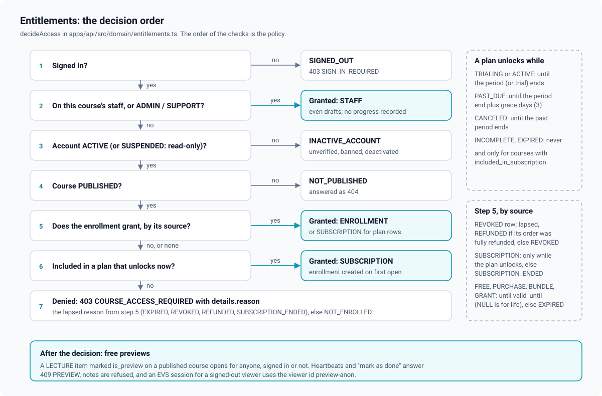

# Entitlements: who may open course content

One pure function decides whether a viewer may open a course's content:
`decideAccess(facts)` in [`apps/api/src/domain/entitlements.ts`](../../apps/api/src/domain/entitlements.ts).
One service loads the facts for it and turns the decision into an HTTP answer:
[`apps/api/src/services/access.service.ts`](../../apps/api/src/services/access.service.ts).
Nothing else in the codebase reads enrollments to decide access
([ADR 0012](adr/0012-entitlements-as-one-pure-function.md)).

This is the fix for two defects of the system this one replaces: paid courses that could
be enrolled in for free through the free-enroll endpoint, and access checks that were
always truthy (an existing enrollment row of any kind, or a client flag, was enough).

## The facts

```ts
interface AccessFacts {
  course: { status; accessMode; includedInSubscription };
  viewer: { role; active } | null;          // null = signed out
  staffRole: "OWNER" | "EDITOR" | "GRADER" | null;
  enrollment: { source; status; validUntil; refunded } | null;
  subscription: { status; currentPeriodEnd; trialEnd } | null;
  now: Date;
  graceDays: number;                        // settings.learning.subscriptionGraceDays
}
```

`accessFacts()` loads them in three queries run together: the viewer's `course_staff` role,
their one `enrollments` row for the course joined to its order (for `refunded =
order.status = 'REFUNDED'`), and their most recent subscription in `TRIALING`, `ACTIVE`,
`PAST_DUE` or `CANCELED`. `viewer.active` is true for `ACTIVE` and `SUSPENDED` accounts: a
suspension makes an account read-only, it does not take away courses it paid for (writes
are refused separately by `requireActive`).

## The decision order



The order of the checks is the policy:

1. **No viewer**: `SIGNED_OUT`.
2. **Staff**: anyone on the course staff (any role) and the see-all platform roles
   (`ADMIN`, `SUPPORT`) are granted `via: "STAFF"`, even to drafts, so they can author and
   review. Instructors on other courses get nothing from this rule.
3. **Inactive account** (`PENDING_VERIFICATION`, `BANNED`, `DEACTIVATED`): `INACTIVE_ACCOUNT`.
4. **Not published** (DRAFT or ARCHIVED): `NOT_PUBLISHED`. The service turns this into a
   404 so a learner can never confirm that a draft exists.
5. **An enrollment** grants by its source:
   - `REVOKED`: lapsed with `REFUNDED` when its order was fully refunded, else `REVOKED`;
   - `SUBSCRIPTION`: granted `via: "SUBSCRIPTION"` only while the plan unlocks the course
     (below), else lapsed with `SUBSCRIPTION_ENDED`;
   - every other source (`FREE`, `PURCHASE`, `BUNDLE`, `GRANT`): granted
     `via: "ENROLLMENT"` until `valid_until` (NULL means for life), else lapsed with
     `EXPIRED`.
6. **No usable enrollment, but an active plan**: when the course has
   `included_in_subscription` and the subscription grants access, granted
   `via: "SUBSCRIPTION"`. On first open the service creates (or re-points) the enrollment
   row with source `SUBSCRIPTION`, so progress has a home.
7. Otherwise the lapsed reason from step 5, or `NOT_ENROLLED`.

A lapsed enrollment reports why, so the course page can say "Your access expired" or
"Your subscription ended" instead of a generic "Enroll". The pure function is pinned by
[`apps/api/test/unit/entitlements.test.ts`](../../apps/api/test/unit/entitlements.test.ts).

## Subscription grace

`subscriptionGrantsAccess(sub, now, graceDays)`:

| Status | Unlocks included courses while |
| --- | --- |
| `TRIALING`, `ACTIVE` | the period (or trial) end is in the future, or unknown |
| `PAST_DUE` | the period end plus `graceDays` (default 3) is in the future: a failed renewal does not lock a learner out mid-lesson |
| `CANCELED` | the period end is in the future: cancelling stops renewals, not the period already paid for. An immediate cancel sets the period end to now |
| `INCOMPLETE`, `EXPIRED` | never |

The gateways move the row between these states ([payments.md](payments.md#7-subscriptions));
`billing.expire-subscriptions` sets `EXPIRED` once the period plus grace has ended. Access
itself is never written anywhere: it is computed from the row on every request.

## Lapsed reasons

| Reason | Means | Course page state (`CourseAccess`) |
| --- | --- | --- |
| `SIGNED_OUT` | No session | `SIGNED_OUT` (with the price or `free`) |
| `INACTIVE_ACCOUNT` | Not verified, banned or deactivated | (sign-in flow) |
| `NOT_PUBLISHED` | Draft or archived | 404 |
| `NOT_ENROLLED` | Never had access | `FREE`, `PURCHASABLE`, `SUBSCRIPTION_REQUIRED`, `INCLUDED_IN_PLAN` or `UNAVAILABLE` |
| `EXPIRED` | A grant or purchase past `valid_until` | `LAPSED` |
| `REVOKED` | An operator revoked it | `LAPSED` |
| `REFUNDED` | Revoked because its order was refunded | `LAPSED` |
| `SUBSCRIPTION_ENDED` | A SUBSCRIPTION enrollment whose plan no longer unlocks | `LAPSED` |

The HTTP answer for a published course without access is
`403 COURSE_ACCESS_REQUIRED` with `details.reason` (and `details.courseSlug` on item
routes); a signed-out caller gets `403 SIGN_IN_REQUIRED`.

## Free previews

`requireItemAccess` adds one exception after the decision: a **LECTURE** item with
`is_preview` on a **published** course opens for anyone, signed in or not. Quizzes and
assignments are never previews (the editor refuses with `PREVIEW_LECTURES_ONLY`). A
preview opens content only: heartbeats and "mark as done" answer `409 PREVIEW`, a note
answers `403 COURSE_ACCESS_REQUIRED` (`reason: NOT_ENROLLED`), and an EVS preview session
is minted for the viewer id `preview-anon` when signed out. A signed-in viewer may still
bookmark a preview item.

## Where it is enforced

| Caller | Check | File |
| --- | --- | --- |
| Classroom shell `GET /api/learn/:courseSlug` | `requireCourseAccess` (creates the SUBSCRIPTION enrollment) | [`services/classroom.service.ts`](../../apps/api/src/services/classroom.service.ts) |
| Item content, playback, heartbeats, mark done, bookmarks | `requireItemAccess` | `classroom.service.ts`, [`services/playback.service.ts`](../../apps/api/src/services/playback.service.ts) |
| Notes | `requireCourseAccess` (list), `requireItemAccess` (create; previews refused) | [`services/note.service.ts`](../../apps/api/src/services/note.service.ts) |
| Quiz attempts, assignment submissions | `requireItemAccess`, then staff are refused with `409 STAFF_PREVIEW` | [`services/quiz.service.ts`](../../apps/api/src/services/quiz.service.ts), [`services/submission.service.ts`](../../apps/api/src/services/submission.service.ts) |
| Q&A and reporting Q&A posts | `requireCourseAccess` | [`services/qa.service.ts`](../../apps/api/src/services/qa.service.ts), [`services/report.service.ts`](../../apps/api/src/services/report.service.ts) |
| Reviews | `decide` (granted via ENROLLMENT or SUBSCRIPTION, not STAFF) plus the progress minimum | [`services/review.service.ts`](../../apps/api/src/services/review.service.ts) |
| Lecture PDFs and resources through `GET /api/media/:id` | `decide` on the owning course | [`services/media.service.ts`](../../apps/api/src/services/media.service.ts) |
| The course page `access` block | `decide` plus the price book | [`services/catalog.service.ts`](../../apps/api/src/services/catalog.service.ts) |
| Checkout `alreadyOwned` (409 `ALREADY_OWNED`) | `decide` for every course in the item | [`services/checkout.service.ts`](../../apps/api/src/services/checkout.service.ts) |
| My Learning (`active` per row) and the admin learner detail | `decideAccess` on batch-loaded facts | [`services/my-learning.service.ts`](../../apps/api/src/services/my-learning.service.ts), [`presenters/admin-learners.presenter.ts`](../../apps/api/src/presenters/admin-learners.presenter.ts) |
| Free enrollment | `canSelfEnrollFree`: published, `FREE`, active account (`403 NOT_FREE` otherwise) | [`services/catalog.service.ts`](../../apps/api/src/services/catalog.service.ts) |

Authoring is a separate question with its own check, `requireCourseStaff`
([LLD.md](LLD.md#42-authoring-the-admin-course-editor)).

## How enrollments are written

All writes go through [`services/enrollment.service.ts`](../../apps/api/src/services/enrollment.service.ts):

- `grantEnrollment` is an upsert on `(user_id, course_id)` under `FOR UPDATE`. It never
  shortens access: a live lifetime enrollment stays lifetime (and keeps its source when an
  admin grant lands on top of a purchase), otherwise the later end date wins. A revoked
  row is reactivated with its progress. A SUBSCRIPTION row bought outright becomes the
  purchase.
- `revokeEnrollment` sets `REVOKED` with a reason and keeps the row and its progress.
- Sources: checkout fulfilment (`PURCHASE`, `BUNDLE`), free enroll (`FREE`), admin grants
  (`GRANT`, with `valid_until` and a note), first open under a plan (`SUBSCRIPTION`).

A refund with "revoke access" revokes the order's enrollments; once the order is fully
refunded the decision reports `REFUNDED`. A partial refund that does not revoke leaves
access as it was.
