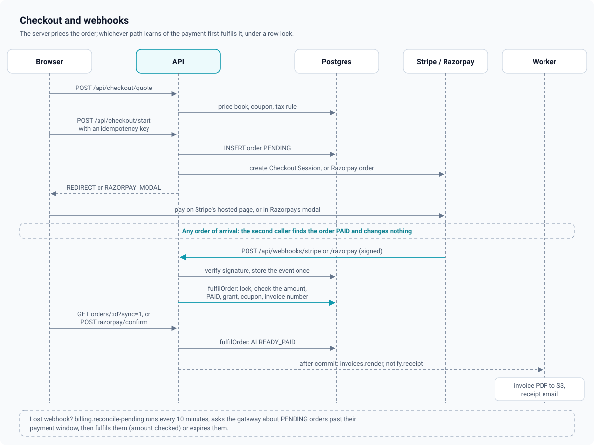

# Payments

How money becomes access: the price book, quotes, starting a checkout, the two gateways,
webhooks, fulfilment, subscriptions, refunds, invoices and the jobs that clean up after
lost events. Setting up real Stripe and Razorpay accounts is in
[guides/payments.md](../guides/payments.md); the wire format of the webhooks is in
[api/webhooks.md](../api/webhooks.md).

The rules that shape everything below:

- **The server prices every order** from its price book. A client sends what it wants to
  buy, the currency and an optional coupon code; it never sends an amount
  ([ADR 0013](adr/0013-money-in-minor-units-with-a-server-price-book.md)).
- **Money is integer minor units** with its currency, end to end, including the CHECK
  constraint that ties an order's total to its parts.
- **A webhook is trusted for whether the buyer paid, never for how much.** The captured
  amount and currency must equal the order's.
- **One function turns payment into access**: `fulfilOrder`, whichever path learned of the
  payment first ([ADR 0014](adr/0014-one-fulfilment-path.md)).



## 1. The gateway interface

[`apps/api/src/services/payments/gateway.ts`](../../apps/api/src/services/payments/gateway.ts)
defines `PaymentGateway`; [`stripe.ts`](../../apps/api/src/services/payments/stripe.ts) and
[`razorpay.ts`](../../apps/api/src/services/payments/razorpay.ts) implement it as thin REST
clients over `fetch` (no SDKs), with timeouts and `redirect: "error"`. Base URLs come from
`STRIPE_API_BASE` and `RAZORPAY_API_BASE`, which is how the local stubs stand in for both.

| Method | Stripe | Razorpay |
| --- | --- | --- |
| `ensureCustomer` | `POST /v1/customers` (idempotency key `customer-<userId>`), stored in `gateway_customers` | none (returns null) |
| `createRecurringPlan` | `POST /v1/prices` with `recurring[interval]` | `POST /v1/plans` (monthly or yearly) |
| `createCheckout` | Checkout Session, `mode=payment`, one line per order line at its final amount, `expires_at` clamped to 31 min to 23 h | `POST /v1/orders` with `notes.order_id` |
| `createSubscription` | Checkout Session, `mode=subscription`, the cached recurring Price, `trial_period_days`, a once-only Stripe coupon for a first-payment discount | `POST /v1/subscriptions` (`total_count` 120 monthly or 10 yearly, `start_at` for a trial) |
| `resumeHandoff` | The session again if still `open` | The same order or subscription id |
| `verifyClientReturn` | Always false: the browser's return carries only a session id | HMAC-SHA256 of `order_id\|payment_id` (or `payment_id\|subscription_id`) with the key secret, constant time |
| `parseWebhook` | `Stripe-Signature` verified first ([section 5](#5-webhooks)) | `X-Razorpay-Signature` verified first |
| `fetchPayment` | PaymentIntent | Payment (captured if only authorized) |
| `fetchOrderStatus` | Checkout Session status and amount | Order and its captured payment; subscriptions report only PENDING or EXPIRED |
| `refund` | `POST /v1/refunds` (idempotency key `refund-<refundId>`, resolving an invoice ref to its PaymentIntent) | `POST /v1/payments/:id/refund` with `notes.refund_id` |
| `cancelSubscription` | `cancel_at_period_end=true`, or `DELETE` now | `/cancel` with `cancel_at_cycle_end` |
| `resumeSubscription` | `cancel_at_period_end=false` | not supported (`409 RESUME_NOT_SUPPORTED`) |

Every implementation normalises gateway events to one `NormalizedEvent` shape
(`PAYMENT_SUCCEEDED`, `PAYMENT_FAILED`, `REFUND_SUCCEEDED`, `REFUND_FAILED`,
`SUBSCRIPTION_UPDATED`, `SUBSCRIPTION_RENEWED`, `SUBSCRIPTION_PAYMENT_FAILED`,
`SUBSCRIPTION_CANCELED`, `IGNORED`). The normalisers are pure and unit-tested
([`apps/api/test/unit/commerce-gateways.test.ts`](../../apps/api/test/unit/commerce-gateways.test.ts)).

## 2. Price book, currencies and routing

- `prices` holds one **active** price per sellable (course, bundle, plan), currency and,
  for plans, interval (partial unique indexes). Editing prices deactivates the old rows.
- `settings.currencies` lists the enabled currencies and the default; a quote in any other
  currency is `400 CURRENCY_NOT_SUPPORTED`. A course with no price in the requested
  currency is `409 PRICE_NOT_AVAILABLE`; there is no conversion between currencies.
- The buyer picks a currency among the enabled ones (the currency menu, stored in
  `localStorage` `lms:currency`, else the account's `preferred_currency`, else the default).
  This replaces a defect of the old system, where the client chose the currency and the
  amount; here the client chooses only which of the academy's own prices to pay.
- `routeCurrency(settings, currency)` picks the gateway: `settings.gateways.routing[currency]`
  else `fallback`, only if that gateway is configured and takes the currency. Razorpay takes
  only `INR` (`RAZORPAY_CURRENCIES`); Stripe takes any. If the routed gateway cannot, the
  other one is tried; if neither can, `409 CURRENCY_NOT_PAYABLE`. Defaults:
  `{ routing: { INR: "RAZORPAY" }, fallback: "STRIPE" }`.
- A gateway is configured when its secret key is set and is not the Terraform placeholder
  `set-me` (`stripeEnabled`, `razorpayEnabled` in
  [`core/config.ts`](../../apps/api/src/core/config.ts)).

## 3. Pricing: coupon, then tax

[`apps/api/src/domain/pricing.ts`](../../apps/api/src/domain/pricing.ts), `price(lines, coupon, tax)`:

1. **Subtotal** is the sum of price-book amounts.
2. **Coupon** discounts the subtotal: PERCENT is `round_half_up(eligible * percent / 100)`,
   FIXED is `min(eligible, amount_off)`. The discount is spread over the lines in
   proportion with the largest-remainder method, so the parts are integers that sum
   exactly.
3. **Tax** applies to each discounted line at `rateBps` (basis points): EXCLUSIVE adds
   `round_half_up(net * rate / 10000)` on top; INCLUSIVE carves
   `net - round_half_up(net * 10000 / (10000 + rate))` out of the price. Each line is rounded
   on its own so lines sum to the total.

The tax rule is `settings.tax.rules` matched by the buyer's billing country (an exact
country, else `*`, else none), only when `settings.tax.enabled`. The mode, rate, label and
country are frozen on the order (`orders.tax`) and the database checks
`total = subtotal - discount + (EXCLUSIVE ? tax : 0)`.

Coupon validity is `couponProblem` (inactive or expired, not started, exhausted, already
used by this learner up to `per_user_limit`, FIXED in another currency, not applicable to
the item) plus the scope (`ALL`, `COURSES`, `BUNDLES`, `PLANS`, or `SPECIFIC` through
`coupon_targets`). On plans a coupon discounts the **first payment only**, and is not
applicable during a free trial or on Razorpay (a Razorpay subscription cannot carry a
one-off discount). A quote returns an invalid coupon as `couponError`; starting with one
is `409 COUPON_INVALID` with `details.reason`.

## 4. Starting a checkout

`POST /api/checkout/start` ([`apps/api/src/services/checkout.service.ts`](../../apps/api/src/services/checkout.service.ts)):

1. `requireActive`. Look up `(user_id, idempotency_key)`: an existing order returns its
   handoff again (the same Stripe session, the same Razorpay order). The web app keeps one
   key per item and set of quote terms in `sessionStorage`
   ([`apps/web/src/lib/checkout.ts`](../../apps/web/src/lib/checkout.ts)), so a double
   click, a reload or a retried request reuses the same order; changing the currency or the
   coupon makes a new key.
2. Build the quote on the server (section 3). `409 ALREADY_OWNED` when the learner can
   already open every course in the item (the entitlement decision); `409 SUBSCRIPTION_EXISTS`
   when buying a plan with a live subscription.
3. In one transaction: expire the learner's stale INCOMPLETE plan checkouts (closing their
   PENDING orders as `CANCELED` / `SUPERSEDED`), insert the order `PENDING` with its line,
   frozen tax and billing, payable until now plus `settings.learning.orderTtlMinutes` (60),
   and for a plan the `subscriptions` row `INCOMPLETE` with a placeholder ref
   `pending_<orderId>`. A unique violation (another live plan checkout, or the same key
   racing) is `409 CHECKOUT_IN_PROGRESS`, or the winner's handoff.
4. A zero total (a 100% coupon on a one-time item) is fulfilled at once with gateway `FREE`.
5. Otherwise create the Stripe Customer if needed, then the Checkout Session or Razorpay
   order or subscription, store `gateway_ref`, and return the handoff. A gateway failure
   closes the order as `FAILED` (`GATEWAY_ERROR`) and answers `502 GATEWAY_ERROR`.

The handoff (`CheckoutHandoff` in [`packages/types/src/commerce.ts`](../../packages/types/src/commerce.ts)):

| Type | The web app does |
| --- | --- |
| `REDIRECT` (Stripe) | Full-page redirect to Stripe's hosted Checkout. Stripe returns to `/checkout/orders/<id>?session_id=...`; the page calls `GET /api/checkout/orders/:id?sync=1`, which asks Stripe once about a still-PENDING order and fulfils it if paid. The webhook usually got there first |
| `RAZORPAY_MODAL` | Loads Checkout.js from `RAZORPAY_CHECKOUT_SCRIPT_URL` and opens the modal with the order or subscription id. On success the handler posts `{ razorpay_payment_id, razorpay_order_id or razorpay_subscription_id, razorpay_signature }` to `POST /api/checkout/razorpay/confirm` |
| `FULFILLED` | Nothing to pay (zero total, or a retried start of a paid order) |

The mobile app uses the same handoff. For Stripe it starts checkout with
`returnUrl: "<web origin>/checkout/app-return?app=openlms"` and opens the hosted page in a
Custom Tab (Android) or an authentication session (iOS). Stripe documents an https
`success_url` for mobile apps (a universal or app link, with a page that links into the
app's scheme as the fallback), so the return is a real page on the web origin:

1. `checkoutReturnUrl` (`domain/safe-url.ts`) accepts it because it is on the web origin;
   checkout appends `orderId` and `session_id` (or `canceled=1`), so Stripe returns to
   `/checkout/app-return?app=openlms&orderId=<id>&session_id=...`.
2. The page ([`apps/web/src/app/(main)/checkout/app-return/page.tsx`](../../apps/web/src/app/(main)/checkout/app-return/page.tsx))
   checks `app` against `MOBILE_RETURN_SCHEMES` (served as `mobile.appReturnSchemes` in
   `GET /api/meta`, default `openlms`) and, when allowed, immediately opens
   `openlms://checkout/return?orderId=<id>` (`&canceled=1` after a cancel). It also shows a
   fallback: the academy name, "Payment received" or "Payment canceled", "Return to the
   app" with the same link, and "Continue on the website" to the order page. A scheme that
   is not allowed gets no redirect and no app button (`apps/web/src/lib/app-return.ts`).
3. The app polls `GET /api/checkout/orders/:id?sync=1` until the order is paid.

Any other `returnUrl` is `400 RETURN_URL_NOT_ALLOWED`, so checkout is never an open
redirect. A custom-scheme `returnUrl` (`openlms://...`, any scheme in
`MOBILE_RETURN_SCHEMES`) is also accepted and is what the local stub flow uses, but it is
not the documented path for real Stripe: production apps should use the https page above. For Razorpay the
handoff carries `mode`: `native` (the app opens the Razorpay SDK with the same options) or
`stub`, when `RAZORPAY_CHECKOUT_SCRIPT_URL` points at the local stubs; then
`checkoutPageUrl` is a full-page copy of the stub modal whose Pay redirects to
`openlms://checkout/razorpay` (or the page's `redirect` parameter) with the signed fields,
which the app posts to the same confirm endpoint. Some storefronts do not allow buying
digital content outside their own billing: `settings.mobile.iosWebPurchaseLink` (in
`GET /api/meta`) tells the iOS app whether it may link to web checkout at all.

`razorpayConfirm` checks that the order is the learner's and paid through Razorpay, that
the claimed id equals the order's `gateway_ref`, and verifies the signature in constant
time; then it fetches the payment from Razorpay, checks it belongs to that order, and only
if `CAPTURED` calls `fulfilOrder` with the **fetched** amount. A bad signature is
`400 PAYMENT_NOT_VERIFIED`.

A learner may cancel an unpaid order (`POST /api/checkout/orders/:id/cancel`): PENDING to
CANCELED, and its INCOMPLETE subscription row is expired.

## 5. Webhooks

`POST /api/webhooks/stripe` and `POST /api/webhooks/razorpay`, raw body, no auth
([`apps/api/src/services/payments/webhook.service.ts`](../../apps/api/src/services/payments/webhook.service.ts)):

1. **Verify first.** `parseWebhook` checks the signature over the exact bytes in constant
   time before parsing anything. Stripe: `t=<unix>,v1=<hex>` with
   `HMAC-SHA256(STRIPE_WEBHOOK_SECRET, "<t>.<raw body>")`, any of several `v1` values,
   within 300 s. Razorpay: hex `HMAC-SHA256(RAZORPAY_WEBHOOK_SECRET, raw body)` in
   `X-Razorpay-Signature`. A missing secret or a bad signature is `400`, logged, nothing
   stored.
2. **Store once.** `INSERT INTO payment_events ... ON CONFLICT (gateway, event_id) DO NOTHING`
   with the body redacted ([`redact.ts`](../../apps/api/src/services/payments/redact.ts):
   card, bank, UPI, email, phone and address fields at any depth, and any string that looks
   like an email). The event id is Stripe's `evt_...` or Razorpay's `X-Razorpay-Event-Id`
   (a hash of the body when absent). Nothing inserted means a redelivery: `200
   { duplicate: true }`, not processed again.
3. **Process.** The order is found by `(gateway, gateway_ref)`, unique per gateway; before
   the ref is stored (a webhook that beat the start request), by the `order_id` the API put
   in the gateway's metadata, accepted only if that order's ref is still NULL. Business
   rules saying no (`ORDER_NOT_FOUND`, `AMOUNT_MISMATCH`, `IGNORED_PAID`, a `4xx` from a
   service as `REJECTED_<code>`) are an **outcome** recorded on the event and still a 200,
   so the gateway stops retrying.
4. **Unexpected errors** (the database is down) delete the stored event and answer 500, so
   the gateway's retry is processed instead of being taken for a duplicate.

Events acted on:

| Normalised | Stripe | Razorpay | Handler |
| --- | --- | --- | --- |
| `PAYMENT_SUCCEEDED` | `checkout.session.completed`, `checkout.session.async_payment_succeeded` (when `payment_status` is paid) | `payment.captured`, `order.paid` | `fulfilOrder` |
| `PAYMENT_FAILED` | `checkout.session.async_payment_failed`, `checkout.session.expired` (to EXPIRED) | `payment.failed` | `closeOrder` (PENDING only) |
| `SUBSCRIPTION_UPDATED` | `customer.subscription.created`, `.updated`, `.resumed`, `.paused` | `subscription.authenticated`, `.activated`, `.updated`, `.resumed` | `onSubscriptionUpdated` |
| `SUBSCRIPTION_RENEWED` | `invoice.paid` | `subscription.charged` | `onRenewed` |
| `SUBSCRIPTION_PAYMENT_FAILED` | `invoice.payment_failed` | `subscription.pending`, `.halted` | `onPaymentFailed` |
| `SUBSCRIPTION_CANCELED` | `customer.subscription.deleted` | `subscription.cancelled`, `.completed` | `onCanceled` |
| `REFUND_SUCCEEDED` / `REFUND_FAILED` | `charge.refunded`, `refund.created`, `refund.updated`, `charge.refund.updated` | `refund.processed`, `refund.failed` | `onRefundEvent` |

Everything else is stored with outcome `IGNORED`.

## 6. Fulfilment

`fulfilOrder(orderId, capture, source)` in
[`apps/api/src/services/payments/fulfilment.service.ts`](../../apps/api/src/services/payments/fulfilment.service.ts)
is called by the webhook, the Razorpay confirm, the Stripe return page (`?sync=1`), the
reconcile job, free orders, and a first subscription charge whose checkout event was lost.
In one transaction:

1. **Lock the order** (`SELECT ... FOR UPDATE`). Concurrent callers queue here.
2. Already `PAID`, `PARTIALLY_REFUNDED` or `REFUNDED`: `ALREADY_PAID`, a no-op.
3. Not payable (`CANCELED`): flag `PAID_AFTER_CANCEL`, audit `order.paid_after_cancel`,
   grant nothing; staff refund it from the order page.
4. **Amount check**: `amountMatches` (same minor units, same currency). A mismatch flags
   `AMOUNT_MISMATCH`, audits `order.amount_mismatch` with the expected and captured values,
   leaves the order PENDING for staff, grants nothing.
5. **Conditional update to PAID** from the statuses the state machine allows.
6. **Grant**: a course is an enrollment with source PURCHASE; a bundle is one enrollment
   per course with source BUNDLE; a plan activates its subscription row (section 7).
7. **Coupon**: count the redemption under its cap and insert `coupon_redemptions`. A coupon
   that ran out between quote and payment still honours the price paid; the overrun is
   audited (`coupon.over_redeemed`).
8. **Invoice** with a gap-free number (section 9), notification `ORDER_PAID`, audit
   `order.paid`.
9. After commit: `invoices.render` and `notify.receipt`.

The order state machine is [`apps/api/src/domain/orders.ts`](../../apps/api/src/domain/orders.ts):

```
PENDING -> PAID | FAILED | EXPIRED | CANCELED
FAILED  -> PAID              (Razorpay can capture after a failed first attempt)
EXPIRED -> PAID              (a late webhook for money that really was taken)
PAID    -> PARTIALLY_REFUNDED | REFUNDED
PARTIALLY_REFUNDED -> PARTIALLY_REFUNDED | REFUNDED
```

Every move is `UPDATE ... WHERE id = ? AND status = ANY(<sources>)`. A late "payment
failed" after PAID changes nothing: money taken is only un-taken by a refund.

Races this handles:

| Race | Result |
| --- | --- |
| Webhook and Stripe return page (or Razorpay confirm) at the same moment | The order lock serialises them; the second sees PAID and returns `ALREADY_PAID` |
| The same webhook delivered twice, or concurrently | The second `INSERT` into `payment_events` inserts nothing |
| Webhook before the start request stored `gateway_ref` | Resolved through the order id in the gateway metadata, then the ref is stored |
| A double-clicked "Pay" | Same idempotency key, same order and handoff |
| Two plan checkouts in two tabs | The one-live-subscription partial unique index; the second is `409 CHECKOUT_IN_PROGRESS` |
| A payment for an order the learner cancelled | `PAID_AFTER_CANCEL`, flagged for a refund |
| A webhook claiming a different amount | `AMOUNT_MISMATCH`, nothing granted |
| Coupon cap reached between quote and payment | Honoured and audited |

## 7. Subscriptions

[`apps/api/src/services/subscription.service.ts`](../../apps/api/src/services/subscription.service.ts).

```
INCOMPLETE --first payment (fulfilment, amount checked)--> TRIALING | ACTIVE
ACTIVE / TRIALING --renewal failed--> PAST_DUE --renewed--> ACTIVE
ACTIVE / TRIALING / PAST_DUE --cancel at period end--> CANCELED (cancel_at_period_end)
                              --resume (Stripe only)--> ACTIVE / TRIALING
any live state --ended at the gateway, or an immediate cancel--> CANCELED (period end = now)
TRIALING / ACTIVE / PAST_DUE / CANCELED --period + grace over--> EXPIRED (job)
INCOMPLETE --checkout abandoned or superseded--> EXPIRED
```

- **Activation** happens only in fulfilment, after the amount check. Gateway status events
  on an INCOMPLETE row are recorded as `AWAITING_FIRST_PAYMENT`. The period comes from the
  gateway when it reports one, else one interval from now so access starts at once. A late
  payment for an abandoned checkout revives its row unless the learner has another live
  subscription by then.
- **Stripe's ids** are learned from the session and from `metadata.subscription_id`;
  `pending_<orderId>` is replaced once.
- **Status updates** map Stripe `trialing`/`active` (a pending cancel reads as CANCELED),
  `past_due`/`unpaid`, `canceled`, `incomplete_expired`; Razorpay `active`, `authenticated`
  (a trial), `pending`/`halted`/`paused` (PAST_DUE), `cancelled`, `completed`/`expired`.
  A hard-ended row (EXPIRED, or CANCELED without a pending period end) is never revived by
  later status events.
- **Renewals** (`invoice.paid` with `billing_reason` other than `subscription_create`,
  `subscription.charged` after the first) create an order of kind SUBSCRIPTION, already
  PAID, with its own invoice, idempotency key `renewal:<gateway invoice or payment id>` (a
  redelivered renewal is `DUPLICATE_RENEWAL`). The charged amount must equal the
  subscription's `amount_minor` and currency, else `AMOUNT_MISMATCH` is audited and nothing
  is recorded. The tax is the first order's, recomputed; if it does not reproduce the
  stored amount, the renewal is invoiced without a tax line.
- **Cancel**: the learner's cancel is always at period end
  (`POST /api/billing/subscription/cancel`); ADMIN and FINANCE may also cancel now. The
  gateway is called first, then the row follows with a conditional update.
- **Resume**: undo a pending cancel while the period is running (Stripe only).
- Access is never written: [entitlements.md](entitlements.md#subscription-grace) reads the
  row, with `settings.learning.subscriptionGraceDays` (3) for PAST_DUE.

## 8. Refunds and credit notes

[`apps/api/src/services/refund.service.ts`](../../apps/api/src/services/refund.service.ts).
Only ADMIN and FINANCE refund (`canRefund`); SUPPORT can read orders.

1. **Request** (`POST /api/admin/commerce/orders/:id/refunds` with `amountMinor`, `reason`,
   `revokeAccess`): lock the order; it must be PAID or PARTIALLY_REFUNDED and have taken a
   payment; the amount must not exceed total minus refunded minus refunds still pending
   (`409 REFUND_EXCEEDS` with `details.refundableMinor`); insert the refund PENDING and
   audit `refund.request`; commit; then ask the gateway.
2. **Settle** on the gateway's answer, synchronous or by webhook, whichever comes first
   (the other is `ALREADY_SETTLED`): lock the order again, add to `refunded_minor` (a
   conditional update that refuses to exceed the total; an over-settlement is audited
   `refund.over_settled` and never corrupts the totals), move to PARTIALLY_REFUNDED or
   REFUNDED, issue a **credit note** with its own gap-free number (`CN-<year>-...`),
   revoke the order's enrollments when asked (and end a refunded plan at the gateway now),
   notify `REFUND_ISSUED`, audit `refund.settle`, then render the PDF and send the refund
   email after commit.
3. A gateway failure marks the refund FAILED and answers `502 GATEWAY_ERROR`.

A refund webhook is matched by the gateway's refund id, or (when it beat the API storing
that id) by the `refund_id` the API put in the refund's metadata or notes.

## 9. Invoices

[`apps/api/src/services/invoice.service.ts`](../../apps/api/src/services/invoice.service.ts):

- Issued inside the transaction that makes it true (an order turning PAID, a renewal, a
  refund settling), at most one invoice per order and one credit note per refund (partial
  unique indexes).
- Numbers come from `invoice_sequences` in the same transaction: `INV-2026-000042`,
  `CN-2026-000003`, per calendar year (UTC), gap-free
  ([ADR 0018](adr/0018-gap-free-invoice-numbering.md)).
- The seller block (from `settings.seller`), the buyer block (from the order's billing
  details) and the lines are frozen on the row; editing the academy's legal details later
  never rewrites an old invoice.
- `invoices.render` draws the PDF with pdfkit and stores it privately at
  `invoices/<yyyy>/<number>.pdf`. Downloads are a 302 to a short-lived signed URL for the
  owner only (`409 INVOICE_RENDERING` until the PDF exists; anyone else gets 404).

## 10. Reconcile and expiry jobs

| Job | Every | Does |
| --- | --- | --- |
| `billing.reconcile-pending` | 10 min | For up to 100 PENDING orders past `expires_at`, oldest first: ask the gateway (`fetchOrderStatus`). Paid: `fulfilOrder` with the gateway's amount. Expired, or still unpaid now that our window closed: `closeOrder(EXPIRED, PAYMENT_WINDOW_CLOSED)`. Unreachable: try again next run. Free or ref-less orders are expired |
| `billing.expire-subscriptions` | 30 min | For subscriptions whose period plus grace ended: if the row still looks live, ask the gateway first and keep a later period end it reports (a lost renewal webhook); otherwise move to EXPIRED |

So a lost webhook costs at most the order window plus one reconcile interval, and only if
the learner also never came back to the return page.

## 11. Known gaps

- `notify.receipt` and `notify.refund` claim a Redis key per order or refund before
  sending (`claimOnce` in `apps/api/src/jobs/billing.jobs.ts`), so a retried job or a
  fulfilment reached from both the webhook and the return page mails the learner once.
- An `AMOUNT_MISMATCH` order stays PENDING for staff; the reconcile job skips it
  (`pendingExpired` in `apps/api/src/repositories/order.repository.ts`), so it is audited once.
- A webhook secret equal to the Terraform placeholder `set-me` counts as unset: the
  webhook is refused rather than verified against a public value.
- If every renewal event for a subscription is lost, the row stays ACTIVE with the old
  period end. ACTIVE and TRIALING get the same `subscriptionGraceDays` as PAST_DUE in
  `subscriptionGrantsAccess`, so the learner keeps access while
  `billing.expire-subscriptions` asks the gateway what really happened.
- Razorpay subscriptions take no first-payment coupon and cannot be resumed after a cancel.
